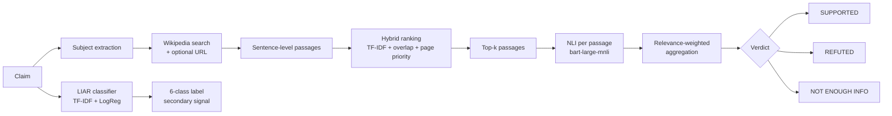
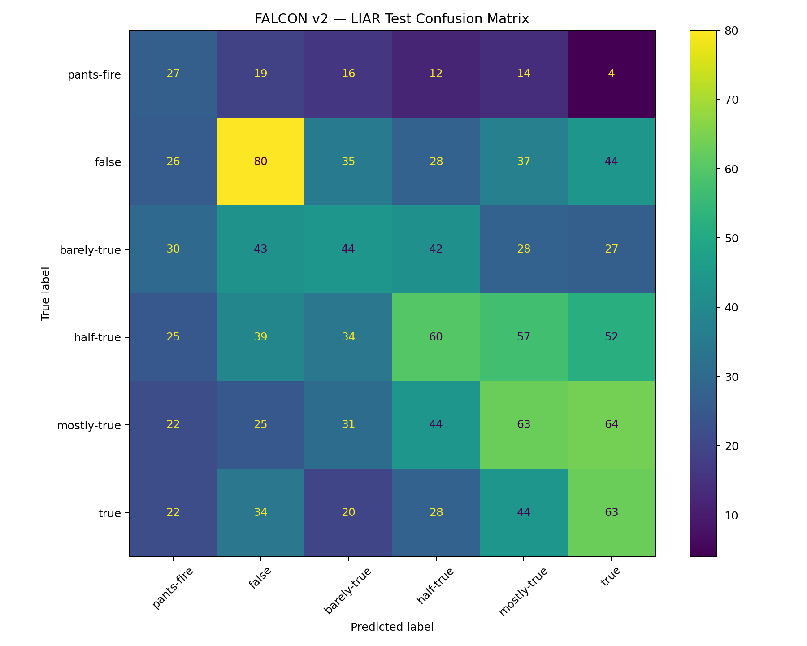
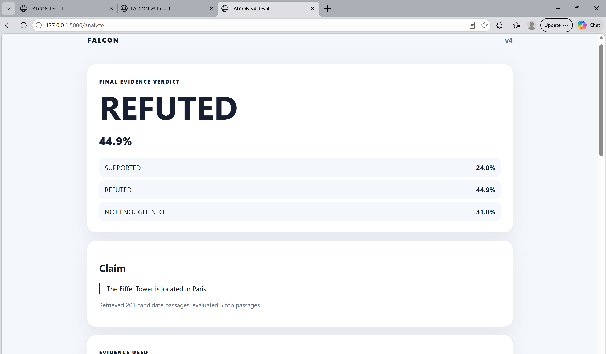
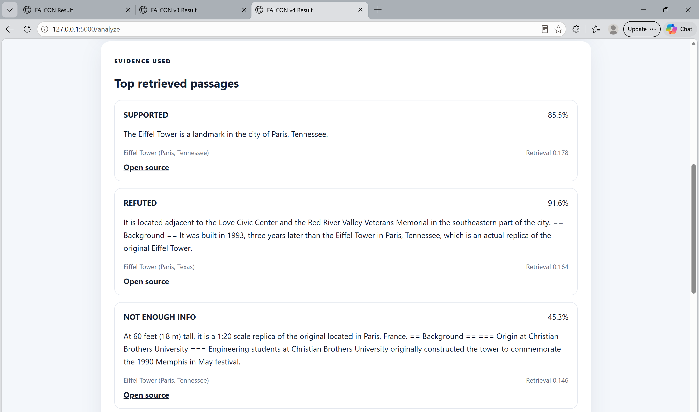

# FALCON — Fake-news Analysis and Claim verificatiON

FALCON is a research prototype for checking short factual claims. It combines two signals:

1. **Linguistic classification.** A TF-IDF + Logistic Regression model trained on the LIAR dataset predicts one of six truthfulness labels from the wording of a claim.
2. **Evidence-based verification.** The system retrieves passages from Wikipedia (and, optionally, a URL the user provides), ranks them by relevance, and uses a Natural Language Inference (NLI) model to decide whether the evidence **supports**, **refutes**, or gives **not enough information** about the claim.

The evidence-based verdict is the main output. The linguistic classifier is reported alongside it as a secondary signal.

> **Status:** working prototype, under active development. The results below describe the current baseline, not a finished system.

---

## Pipeline



| Stage | Module | What it does |
|---|---|---|
| Linguistic classification | `models/classifier.py` | Word (1–2-gram) + character (3–5-gram) TF-IDF features, class-balanced Logistic Regression, six LIAR labels |
| Evidence retrieval | `retrieval/wikipedia_retriever.py`, `retrieval/url_retriever.py` | Extracts the likely subject of the claim, searches Wikipedia for the subject and the full claim, and splits articles into sentence passages |
| Evidence ranking | `retrieval/ranker.py` | Combines TF-IDF similarity, token overlap, title overlap, a lead-sentence bonus, and a page-priority score. Drops low-relevance passages and limits how many passages come from any one article |
| Evidence verification | `verification/nli_verifier.py` | Runs NLI with the evidence as premise and the claim as hypothesis |
| Aggregation | `verification/evidence_aggregator.py` | Averages soft NLI probabilities weighted by relevance² and rank. Returns NOT ENOUGH INFO when the evidence is weak or mixed instead of forcing a verdict |

---

## Results so far

### Linguistic classifier on LIAR (6 classes)

The model is trained on `train`, tuned on `valid`, retrained on `train + valid`, and evaluated once on the untouched `test` split (1,283 statements).

| Metric | Validation | Test |
|---|---|---|
| Accuracy | 23.5% | **26.3%** |
| Macro F1 | 23.7% | **25.8%** |
| Weighted F1 | 23.5% | 26.3% |

How to read these numbers:

- Six-class LIAR is a hard task. Random guessing gives about 17%, and the text-only baselines in the original LIAR paper (Wang, 2017) report roughly 23–27% test accuracy. This baseline is in that range.
- Most errors fall in neighbouring categories. **58.1%** of test predictions land within one category of the true label.
- If the six predicted labels are grouped afterwards into two buckets ({pants-fire, false, barely-true} vs. {half-true, mostly-true, true}), **62.0%** of predictions fall in the correct bucket.

Full reports: [`training/reports/`](training/reports/)



### Evidence-verification evaluation set

[`evaluation/falcon_eval.csv`](evaluation/falcon_eval.csv) contains 60 hand-written claims with balanced labels: 20 SUPPORTED, 20 REFUTED, and 20 NOT ENOUGH INFO. The NOT ENOUGH INFO claims are plausible-sounding statements that are not documented anywhere, used to check that the system does not force a verdict. Run the evaluation with:

```bash
python evaluation/evaluate.py
```

---

## What testing taught me

The most useful lessons came from cases where the system failed.

**1. Relevant is not the same as reliable.** An early version returned **REFUTED** for *"The Eiffel Tower is located in Paris."* The top-ranked passages came from Wikipedia pages about the replica towers in Paris, Texas and Paris, Tennessee. Those passages matched almost every word of the claim, but they were about a different object.

<p align="center">
  
  
</p>

Fixes I made in response:

- Extract the subject of the claim and search for it before searching the whole sentence.
- Prefer exact canonical page-title matches. Penalise parenthetical or disambiguated pages (for example, *"(Paris, Texas)"*) unless the claim mentions them.
- Limit how many top passages one article can contribute.

**2. Hard voting lets a few wrong passages dominate.** The first aggregator multiplied each passage's hard NLI label by its confidence. A few confidently wrong but loosely related passages could overturn one strong supporting passage. The current version averages *soft* probabilities, weights them by relevance squared, and abstains (NOT ENOUGH INFO) when support and refutation are close.

**3. What I am working on now.** A passage can be relevant and still be poor evidence. For example, it may only report what someone *believed* or *claimed*. My current work is on:

- **Attribution detection:** recognising reported speech or belief ("X claimed that…", "it was rumoured…") and down-weighting it.
- **Source prioritisation:** weighting sources by type and reliability instead of treating all retrieved text equally.
- **Evidence-quality filtering:** removing passages that are on-topic but not informative about the claim.
- Evaluating on a standard benchmark such as FEVER, in addition to the hand-built set.

---

## Running locally

```bash
git clone https://github.com/beingbalaji/FALCON-1.git
cd FALCON-1

python -m venv .venv
# Windows: .venv\Scripts\activate
# macOS/Linux: source .venv/bin/activate

pip install -r requirements.txt
python app.py
```

Open http://127.0.0.1:5000. The first verification request downloads the NLI model (about 1.6 GB), so it takes a while.

**API**

```bash
curl -X POST http://127.0.0.1:5000/api/analyze \
     -H "Content-Type: application/json" \
     -d '{"claim": "The Eiffel Tower is located in Paris."}'
```

**Retrain the linguistic classifier:** download LIAR as described in [`training/datasets/liar/README.md`](training/datasets/liar/README.md), then run:

```bash
python training/train_liar_multiclass.py
```

**Tests**

```bash
pytest
```

---

## Project structure

```
FALCON/
├── app.py                     Flask web app and JSON API
├── config.py                  Paths, model names, retrieval settings
├── models/                    LIAR classifier + saved model
├── retrieval/                 Wikipedia / URL retrieval and passage ranking
├── verification/              NLI verification and evidence aggregation
├── training/                  LIAR training script and reports
├── evaluation/                End-to-end evaluation script and claim set
├── templates/, static/        Web UI
└── tests/                     Basic API tests
```

## Limitations

- Wikipedia is currently the only automatic evidence source, so recent, local, or niche claims often get NOT ENOUGH INFO.
- Source credibility is not modelled yet. All retrieved text is treated equally apart from relevance.
- Verdict scores are aggregated evidence scores, **not** calibrated probabilities that a claim is true.
- The LIAR classifier uses only the wording of a claim, without speaker or context metadata, so it is a weak signal on its own.

## References

- W. Y. Wang. *"Liar, Liar Pants on Fire": A New Benchmark Dataset for Fake News Detection.* ACL 2017.
- J. Thorne et al. *FEVER: a Large-scale Dataset for Fact Extraction and VERification.* NAACL 2018.
- M. Lewis et al. *BART: Denoising Sequence-to-Sequence Pre-training.* ACL 2020 (`facebook/bart-large-mnli`).

---

**Author:** Balaji R, B.E. Computer Science and Engineering, Chennai Institute of Technology
